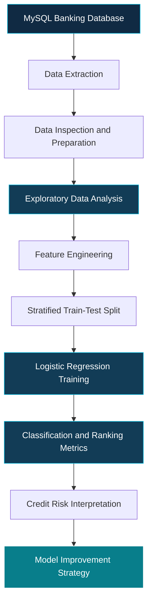

<div align="center">


<br/>


<br/><br/>


<br/><br/>

**A comprehensive data science project focused on customer credit classification, banking data analysis, feature engineering, and machine learning based risk evaluation.**

</div>

---

# 1. Executive Summary

Bank GoodCredit is a data science project that investigates how customer demographics, account information, and credit enquiry records can be used to understand credit risk.

Financial institutions need reliable methods to evaluate customer credit profiles. A customer's historical information can contain patterns associated with responsible credit behaviour or a higher likelihood of repayment difficulties. Analyzing these patterns can help organizations understand their customer portfolios and develop more informed risk assessment strategies.

This project establishes a complete analytical workflow beginning with data extraction from a MySQL database and continuing through data preparation, exploratory data analysis, feature engineering, machine learning, and model evaluation.

The project uses Logistic Regression as its baseline classification algorithm. The model attempts to distinguish between customers with good credit histories and customers associated with bad credit histories.

The primary objective is not simply to achieve a high classification accuracy. It is to understand whether the model can identify the minority bad-credit class reliably and whether its predictions provide meaningful information for credit-risk analysis.

The recorded baseline experiment demonstrates an important machine learning lesson. A model can achieve high overall accuracy while failing to identify the customers who represent the risk category of interest. This makes class-specific evaluation, model validation, and careful interpretation essential parts of the project.

The project therefore combines technical implementation with critical evaluation of model limitations and opportunities for improvement.

# 2. Business Problem

Credit risk assessment is an important analytical activity in banking and financial services.

Before providing loans or other credit facilities, financial institutions need to evaluate the available information about potential customers. This information may include demographic characteristics, existing account details, and previous credit enquiries.

The challenge is to identify meaningful relationships between customer information and credit outcomes.

Traditional analysis can describe the available customer data, but machine learning can help investigate whether combinations of features provide useful predictive information.

However, credit-risk classification introduces several challenges.

First, customer records may contain features with different scales, distributions, and levels of predictive usefulness.

Second, different customer groups may be represented unevenly in the available dataset.

Third, the consequences of classification errors are not necessarily equal. Failing to identify a potentially risky customer may be more important for a particular business objective than incorrectly flagging a customer with a good credit history.

Finally, a model that performs well on historical data may not generalize to future customers.

This project investigates these challenges by developing a baseline classification workflow and evaluating its ability to distinguish between good-credit and bad-credit records.

## Business Objective

The main business objective is to investigate whether historical banking information can support credit-risk classification and to identify the limitations that must be addressed before such a model could be considered for practical use.

## Analytical Objectives

The project focuses on the following objectives.

1. Retrieve and inspect customer-related information stored in MySQL.
2. Understand the structure and characteristics of the available banking data.
3. Explore relationships between customer features and credit-risk labels.
4. Prepare suitable features for a binary classification model.
5. Train a Logistic Regression baseline.
6. Evaluate overall performance and minority-class detection.
7. Investigate the implications of class imbalance.
8. Identify improvements that could make future models more reliable.

# 3. Understanding the Target Variable

The target variable used in the project is `Bad_label`.

It represents the credit classification that the model attempts to predict.

| Target Value | Interpretation      |
| ------------ | ------------------- |
| 0            | Good credit history |
| 1            | Bad credit history  |

The project treats this as a binary classification problem because the target contains two classes.

The distinction between these classes is central to the evaluation process.

A model that correctly predicts a good-credit customer contributes to overall accuracy. A model that correctly identifies a bad-credit customer contributes to the model's ability to detect the risk category.

Both outcomes matter, but the second outcome deserves particular attention because bad-credit customers are the minority class in the recorded test set.

The objective is therefore to investigate not only whether the model makes correct predictions, but also whether it identifies the class that the business analysis is particularly interested in detecting.

# 4. Project Architecture

The project follows a structured data science workflow.

<div align="center">



</div>

Each stage serves a specific purpose.

The database layer provides access to the source information. Data preparation makes the information suitable for analysis. Exploratory analysis helps identify patterns and potential data-quality issues. Feature engineering develops the model inputs. The training stage estimates the classification model, and the evaluation stage determines how well the model performs on unseen test records.

The final stage interprets the results and identifies the changes required for a more reliable solution.

This separation makes the workflow easier to understand, evaluate, reproduce, and extend.

# 5. Data Source and Database Design

The project uses a MySQL database named `project_banking`.

The database contains three tables relevant to the analytical workflow.

| Database Table      | Analytical Purpose                            |
| ------------------- | --------------------------------------------- |
| `Cust_Demographics` | Provides customer demographic information     |
| `Cust_Account`      | Provides customer account-related information |
| `Cust_Enquiry`      | Provides customer credit enquiry information  |

These tables represent different aspects of the customer profile.

Demographic information can help describe the customer population. Account information provides details related to customer banking relationships. Credit enquiry information provides another perspective on customer credit activity.

Combining relevant information from these sources can provide a broader representation of a customer's financial profile than analyzing a single table independently.

The exact relationships between the tables, join conditions, and feature definitions should follow the database schema and the SQL queries implemented in the project notebook.

## Data Access

Python communicates with MySQL through MySQL Connector/Python.

This connection allows the analytical workflow to retrieve database records directly without requiring manual export of every table.

The database integration also demonstrates an important practical data science skill: working with information stored in a relational database rather than relying exclusively on pre-exported CSV files.

Database credentials should remain private. Before publishing the project, any hardcoded credentials must be removed from the notebook and replaced with an environment-based configuration.

# 6. Data Preparation and Exploratory Analysis

Data preparation is a critical stage because the quality of the input data affects the reliability of the resulting analysis.

The project workflow examines the available banking information before model training. This stage establishes an understanding of the records, available features, and target variable.

Exploratory data analysis helps investigate how the customer information is distributed and whether meaningful differences appear between the target classes.

It also provides an opportunity to identify potential issues that could affect model development.

## Data Inspection

The data inspection stage focuses on understanding the available records and the structure of the dataset.

Relevant activities include examining column names, reviewing data types, checking the target variable, and verifying that the features required for modeling are available.

## Target Distribution

Understanding the target distribution is particularly important in this project.

The recorded test set contains 4,579 good-credit records and 201 bad-credit records. This difference indicates that the target classes are substantially imbalanced.

Class imbalance can influence the behaviour of a classifier. A model may learn to predict the majority class frequently while providing poor detection of the minority class.

For this reason, target distribution should be considered before interpreting the model's accuracy.

## Feature Relationships

Exploratory analysis can also help investigate the relationships between customer attributes and credit-risk labels.

The purpose is to identify potential patterns, understand feature behaviour, and guide subsequent model development.

Exploratory observations should not automatically be interpreted as evidence of causation. A relationship between a feature and the target does not establish that the feature causes a particular credit outcome.

# 7. Feature Engineering

Feature engineering transforms available source information into representations that can be used by a machine learning model.

In credit-risk analysis, individual database fields may provide limited information when considered independently. Carefully constructed features can summarize relevant aspects of account activity or credit enquiries.

The project includes feature engineering involving account-related and enquiry-related information.

The resulting features are used as inputs for the baseline classification experiment.

A useful feature engineering process should consider several questions.

Does the feature contain meaningful information about the customer?

Is the feature available at the point when a prediction would be made?

Does the feature contain missing or invalid values?

Could the feature introduce information leakage from the target or from a future event?

Does the feature require scaling, transformation, or a different representation?

These questions are important because a feature can improve performance on historical data without necessarily providing reliable information for future predictions.

The baseline experiment uses 15 numeric features.

Future development can investigate whether alternative feature definitions, additional validation, or a carefully designed preprocessing pipeline improves minority-class detection.

# 8. Machine Learning Methodology

The project uses Logistic Regression as the baseline classification algorithm.

Logistic Regression is a statistical learning method commonly used for binary classification. It estimates the probability that an observation belongs to a particular class based on its input features.

For this project, the model estimates the probability associated with the bad-credit class.

A classification threshold is then used to convert predicted probabilities into class labels.

The selected threshold affects the balance between identifying bad-credit customers and incorrectly classifying good-credit customers.

This is particularly important for imbalanced datasets because the default classification threshold may not provide an appropriate balance for the intended business objective.

## Why Logistic Regression?

Logistic Regression provides a useful starting point for credit-risk modeling because it is relatively straightforward to train and evaluate.

Its coefficients can also provide information about the direction and strength of relationships represented by the fitted model, subject to the effects of feature scaling, correlated inputs, and other modeling considerations.

However, Logistic Regression is not guaranteed to perform well on every dataset.

Its effectiveness depends on the available features, the relationship between those features and the target, the preprocessing process, and the suitability of the classification threshold.

The recorded experiment illustrates why model evaluation must go beyond choosing an algorithm and calculating accuracy.

## Training and Testing Strategy

The baseline experiment uses a stratified train-test split.

| Parameter                 | Recorded Configuration |
| ------------------------- | ---------------------- |
| Training records          | 19,116                 |
| Test records              | 4,780                  |
| Test proportion           | 20 percent             |
| Random state              | 42                     |
| Splitting method          | Stratified             |
| Baseline numeric features | 15                     |
| Classification algorithm  | Logistic Regression    |

A stratified split attempts to preserve the class distribution in the training and test subsets.

The training set is used to estimate model parameters, while the test set is reserved for evaluating the model's performance on records that were not used during fitting.

For reliable experimentation, decisions about feature selection, preprocessing, hyperparameters, and classification thresholds should be made using training data and appropriate validation procedures rather than repeatedly optimizing against the test set.

# 9. Model Evaluation Framework

Evaluating a credit-risk model requires more than one performance metric.

Accuracy measures the proportion of predictions that are correct. However, when one class is much more common than another, accuracy can hide poor performance on the minority class.

Recall measures the proportion of actual members of a class that the model successfully identifies.

Precision measures the proportion of predicted members of a class that actually belong to that class.

The F1-score combines precision and recall into a single measure based on their harmonic mean.

ROC-AUC evaluates how well the model ranks positive examples above negative examples across different classification thresholds.

The Gini coefficient is related to ROC-AUC and provides another way to describe ranking performance.

For credit-risk analysis, these metrics should be interpreted together, with particular attention to the ability to identify bad-credit customers.

## Evaluation Metrics

| Metric           | Purpose                                                  |
| ---------------- | -------------------------------------------------------- |
| Accuracy         | Measures overall classification correctness              |
| Precision        | Measures the reliability of positive predictions         |
| Recall           | Measures how many actual positive cases are identified   |
| F1-score         | Combines precision and recall                            |
| ROC-AUC          | Measures ranking discrimination across thresholds        |
| Gini coefficient | Summarizes discrimination using the ROC-AUC relationship |
| Confusion matrix | Shows correct and incorrect predictions by class         |

The target class of interest must be explicitly identified when interpreting precision, recall, and the confusion matrix. In this project, the key class is `Bad_label = 1`.

# 10. Recorded Baseline Results

The following values represent the recorded baseline experiment.

<div align="center">

<table>
<tr>
<td align="center" width="33%">

<strong>95.79%</strong>

<br/>

Accuracy

</td>
<td align="center" width="33%">

<strong>0.6086</strong>

<br/>

ROC-AUC

</td>
<td align="center" width="33%">

<strong>0.2171</strong>

<br/>

Gini Coefficient

</td>
</tr>
<tr>
<td align="center" colspan="3">

<strong>0.00</strong>

<br/>

Bad-Credit Recall

</td>
</tr>
</table>

</div>

## Interpretation of Accuracy

The baseline achieved an accuracy of 95.79 percent on the test set.

At first glance, this may appear to indicate strong predictive performance. However, accuracy does not describe how the errors are distributed between the two classes.

Because good-credit records substantially outnumber bad-credit records, a classifier can obtain high accuracy by favouring the majority class.

Consequently, accuracy alone cannot establish whether the model is suitable for credit-risk classification.

## Interpretation of ROC-AUC

The recorded ROC-AUC is 0.6086.

This indicates limited discrimination between the two classes. The model's ranking ability is better than random ranking in this experiment, but the result does not establish strong predictive separation.

Further investigation is required to determine whether alternative features, preprocessing strategies, algorithms, or training approaches improve discrimination.

## Interpretation of the Gini Coefficient

The Gini coefficient is calculated from ROC-AUC using the relationship:

`Gini = 2 × ROC-AUC − 1`

For the recorded ROC-AUC of 0.6086, the corresponding Gini coefficient is approximately 0.2172. The notebook records 0.2171, which may reflect rounding or the underlying unrounded metric.

This result reinforces the conclusion that the baseline's ranking performance is limited.

## Interpretation of Bad-Credit Recall

The most significant finding is the recorded bad-credit recall of zero.

At the evaluated classification threshold, the model did not successfully identify the actual bad-credit cases in the test set.

This is a serious limitation for a project whose primary purpose is to investigate bad-credit detection.

The result demonstrates that a high overall accuracy can coexist with complete failure to identify the class that matters most to the intended analysis.

The model therefore needs further development before its predictions can be considered useful for this objective.

## Model Training Warning

The recorded training run also produced a convergence warning.

A convergence warning indicates that the optimization process may not have reached the intended stopping condition within the configured number of iterations.

Potential investigations include reviewing feature scales, checking numerical behaviour, increasing the iteration limit where appropriate, and examining the preprocessing pipeline.

Any changes should be evaluated systematically rather than assuming that resolving the warning will automatically solve the minority-class detection problem.

# 11. Credit Risk Analysis and Interpretation

The purpose of the analysis is to understand whether the available banking features provide useful information about credit risk.

Model coefficients can help investigate the relationship between input features and predicted outcomes. Their interpretation depends on how the features are defined and scaled, and coefficients should not automatically be treated as evidence of causation.

Risk decile analysis can provide another perspective by grouping customers according to predicted risk scores.

In a typical decile analysis, records are ordered by predicted probability and divided into groups. The distribution of actual bad-credit outcomes is then examined across these groups.

A useful risk model would generally be expected to rank higher-risk customers above lower-risk customers more consistently than a weak baseline.

However, decile analysis should not be presented as proof of model quality without checking the actual results and the way the groups were constructed.

For this project, the limited ROC-AUC and zero bad-credit recall indicate that the baseline requires further investigation. Any risk-ranking conclusions should be treated cautiously until improved performance is demonstrated.

# 12. Technical Implementation

The project combines relational data access, data manipulation, statistical analysis, and machine learning in a Python-based workflow.

## Python

Python is the primary programming language used to implement the analysis and model development process.

## MySQL Connector/Python

MySQL Connector/Python provides connectivity between the Python environment and the MySQL database.

It allows the notebook to retrieve the information required for data analysis.

## Pandas and NumPy

Pandas supports tabular data manipulation and analysis, while NumPy provides numerical operations used throughout the analytical workflow.

## Matplotlib and Seaborn

Matplotlib and Seaborn support the creation of charts and statistical visualizations for exploratory analysis and result interpretation.

## Scikit-learn

Scikit-learn provides the baseline Logistic Regression implementation and the utilities required for dataset splitting and model evaluation.

## Jupyter Notebook

Jupyter Notebook combines executable Python code, explanatory text, analytical output, and visualizations in one document.

This format makes the project easier to review because the reader can follow the analysis from data preparation through model evaluation.

# 13. Installation and Reproducibility

The following instructions describe the general setup required to run the project.

## Prerequisites

The environment requires Python, Jupyter Notebook, MySQL Server, and access to the database tables used by the notebook.

The relevant Python packages should be installed using the project's `requirements.txt` file.

## Clone the Repository

```bash
git clone https://github.com/govardhan-goud123/BankGoodCredit.git
cd BankGoodCredit
```

Replace the repository address and directory name with the actual values if your GitHub repository uses a different name.

## Create a Virtual Environment

```bash
python -m venv .venv
```

On Windows, activate the environment using:

```bash
.venv\Scripts\activate
```

## Install the Dependencies

```bash
python -m pip install -r requirements.txt
```

## Configure the Database

Ensure that MySQL Server is running and that the required `project_banking` database and tables are available.

Configure the connection using your local database settings. Do not commit private database credentials to GitHub.

The database records must be available separately unless the project explicitly includes an authorized dataset or database initialization procedure.

## Launch Jupyter Notebook

```bash
jupyter notebook
```

Open the project notebook and execute the cells in the required order.

The results may differ if the database records, package versions, preprocessing steps, or model configuration differ from those used in the original experiment.

For reproducible comparisons, preserve the train-test split configuration and document any changes made to the feature engineering process or classification threshold.

# 14. Repository Organization

The main repository files should reflect the actual contents of the project.

```text
BankGoodCredit/
│
├── README.md
├── requirements.txt
└── YourNotebookName.ipynb
```

Replace `YourNotebookName.ipynb` with the actual notebook filename.

The README documents the project and explains how to run it. The requirements file lists the Python dependencies. The notebook contains the executable analysis and model development workflow.

If additional scripts, reports, or visualizations are added later, the repository structure should be updated to describe those files accurately.

# 15. Limitations and Areas Requiring Further Investigation

The current baseline has several important limitations.

The first limitation is its failure to identify bad-credit customers at the evaluated classification threshold. This prevents the current model from meeting the primary objective of identifying the minority risk class.

The second limitation is class imbalance. The test set contains 4,579 good-credit records compared with 201 bad-credit records. This imbalance makes it essential to evaluate minority-class performance separately from overall accuracy.

The third limitation is the recorded ROC-AUC of 0.6086, which indicates limited discrimination.

The fourth limitation is the convergence warning observed during training. The optimization configuration and numerical behaviour require further examination.

The fifth limitation is that a single train-test split does not provide a complete picture of model stability. Additional validation is required before drawing strong conclusions about generalization.

Finally, historical predictive performance does not establish that a model is fair, explainable, calibrated, or appropriate for real lending decisions.

These limitations should guide the next phase of experimentation.

# 16. Future Development Roadmap

Future development should focus on improving the model's ability to identify bad-credit customers while preserving a rigorous evaluation process.

## Phase One: Baseline Investigation

Review the current Logistic Regression implementation, investigate the convergence warning, verify the preprocessing steps, and confirm that the reported metrics are calculated correctly.

Inspect the confusion matrix and classification report to understand the model's predictions for each class.

## Phase Two: Imbalance-Aware Learning

Experiment with class-weighted Logistic Regression and other appropriate strategies for imbalanced classification.

If resampling techniques are evaluated, apply them only to the training data to avoid contaminating the validation or test sets.

Compare the resulting models using class-specific metrics rather than relying on accuracy alone.

## Phase Three: Model Comparison

Evaluate alternative algorithms such as Random Forest and Gradient Boosting.

Use a consistent evaluation strategy so that performance differences can be compared meaningfully.

The goal is not to select the most complicated algorithm. The goal is to determine which approach provides the most useful and reliable performance for the project's credit-risk objective.

## Phase Four: Threshold Optimization

Investigate the effect of different classification thresholds on precision and recall.

Select a threshold using an appropriate validation process and a clearly defined objective.

The final threshold should reflect the intended balance between identifying risky customers and incorrectly flagging customers with good credit histories.

## Phase Five: Validation and Interpretability

Use cross-validation or another suitable validation approach to investigate model stability.

Evaluate probability calibration where relevant and examine the interpretability of the final model.

Assess potential data leakage, fairness concerns, and the limitations of the available data before considering more practical applications.

## Phase Six: Documentation and Deployment Readiness

Document the final preprocessing pipeline, model configuration, evaluation methodology, and limitations.

A future deployment-oriented version could include a reusable prediction pipeline and a demonstration interface, provided that the model first meets appropriate validation standards.

These are proposed improvements, not completed features of the current baseline.

# 17. Responsible Use of Credit Risk Models

Credit-risk models can influence decisions that have significant financial consequences for individuals.

For this reason, a model should not be evaluated solely on its ability to produce predictions.

A responsible development process should examine data quality, predictive performance, fairness, explainability, privacy, and the consequences of classification errors.

Historical data may also reflect existing biases or patterns that do not generalize to future customers.

The current baseline is intended for educational analysis and experimentation. Its recorded performance does not support using it as a production credit approval or rejection system.

Any future real-world application would require substantially more validation, appropriate governance, security controls, and compliance with applicable requirements.

# 18. Skills Demonstrated

This project provides practical experience in several areas of data science.

**Database and SQL skills**

Connecting Python to MySQL, retrieving relational data, and working with customer information stored across multiple tables.

**Data analysis skills**

Inspecting tabular datasets, understanding target distributions, investigating feature relationships, and interpreting analytical findings.

**Feature engineering skills**

Preparing numerical inputs and investigating how account-related and enquiry-related information can be represented for machine learning.

**Machine learning skills**

Training a Logistic Regression classifier, separating training and testing data, and understanding the role of classification thresholds.

**Model evaluation skills**

Interpreting accuracy, ROC-AUC, Gini coefficient, and class-specific recall while recognizing the limitations of evaluation on imbalanced data.

**Problem-solving skills**

Identifying the difference between apparently strong overall accuracy and actual minority-class detection, then translating that finding into a structured improvement plan.

**Technical documentation skills**

Documenting the business problem, data sources, workflow, model results, reproducibility requirements, and limitations in a professional project format.

# 19. Conclusion

Bank GoodCredit demonstrates a complete baseline workflow for exploring credit-risk classification using banking data, MySQL, Python, and machine learning.

The project begins with relational data access and continues through data preparation, feature engineering, Logistic Regression training, and evaluation.

Its most important result is not the high recorded accuracy. It is the discovery that the baseline fails to identify bad-credit customers at the evaluated threshold despite achieving 95.79 percent accuracy.

This finding highlights a fundamental principle of applied machine learning: evaluation metrics must reflect the actual problem being solved.

A model that performs well on the majority class but fails on the target class cannot be considered successful merely because its overall accuracy is high.

The next stage of development should therefore focus on minority-class detection, model discrimination, threshold selection, and rigorous validation.

Through this project, the data science workflow extends beyond model training to include critical evaluation, technical interpretation, and the identification of practical improvements.

The project provides a foundation for further experimentation with imbalanced classification and more reliable credit-risk analytics.

---

<div align="center">


**Bank GoodCredit**

*A practical exploration of banking data, machine learning, and credit-risk evaluation.*

</div>
