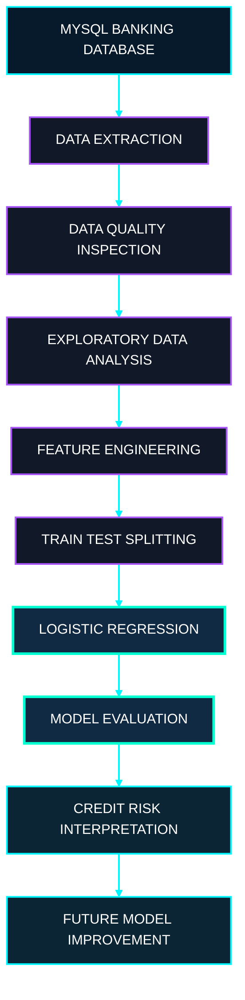
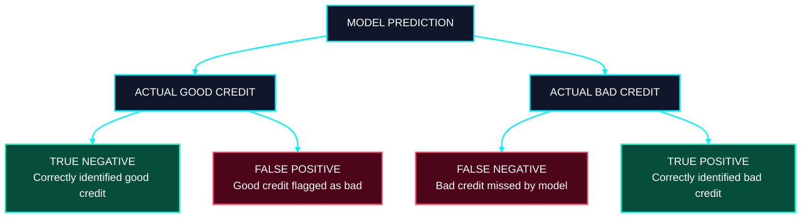
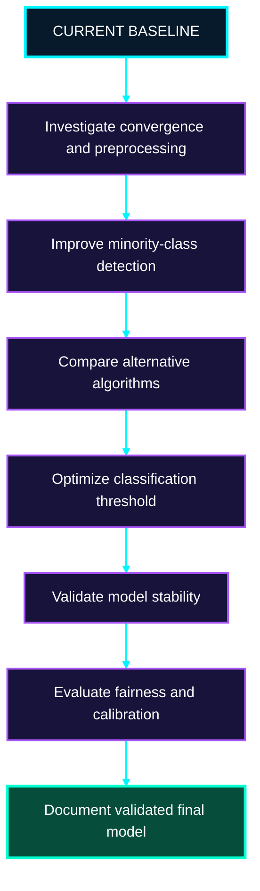

<div align="center">


<br/>


<br/><br/>


<br/><br/>

**A Data Science and Machine Learning Project for Customer Credit Classification, Banking Analytics, and Credit Risk Evaluation.**

<br/>

Developed by **Govardhan Goud**

</div>

---

# 01. Project Overview

Bank GoodCredit is an end-to-end data science project designed to investigate customer credit risk using banking data, SQL, Python, and machine learning.

Financial institutions process large amounts of customer information when assessing creditworthiness. Demographic characteristics, account-related information, and credit enquiry records can provide useful context for understanding customer profiles and identifying patterns associated with credit risk.

The challenge is to transform this information into meaningful analytical features and determine whether a machine learning model can distinguish between customers with good credit histories and customers associated with bad credit histories.

This project develops a structured analytical workflow that begins with data extraction from MySQL and continues through data preparation, exploratory data analysis, feature engineering, classification, and model evaluation.

Logistic Regression is used as the baseline machine learning algorithm. Its predictions are evaluated using several metrics to understand not only the overall classification performance but also the model's ability to identify bad-credit customers.

The recorded baseline demonstrates an important lesson in applied machine learning: a model can achieve high accuracy while failing to detect the minority class that matters most to the intended business problem.

Rather than presenting accuracy as the only measure of success, this project examines the limitations of the baseline and identifies specific directions for improvement.

<div align="center">


</div>

# 02. Business Problem

Credit risk assessment is an important analytical task in banking and financial services.

A financial institution needs to understand the characteristics of its customers and evaluate the likelihood of different credit outcomes. Historical customer information can help reveal patterns that may be useful for risk analysis.

However, identifying these patterns is not straightforward.

Customer data can contain many features, relationships between variables may be complex, and the available target classes may be unevenly distributed. A model can also make different types of errors, and those errors may have different implications for the business.

For example, a model might correctly identify most good-credit customers but fail to recognize customers with bad credit histories. Such a model could produce a high accuracy score without solving the central risk identification problem.

The objective of Bank GoodCredit is to investigate this challenge using a reproducible machine learning workflow.

## Business Objectives

The project aims to:

1. Retrieve relevant banking information from a relational database.
2. Understand customer information through exploratory data analysis.
3. Prepare suitable input features for classification.
4. Train a Logistic Regression baseline.
5. Evaluate the model using multiple classification metrics.
6. Investigate the effect of class imbalance on predictive performance.
7. Identify improvements that could increase the reliability of bad-credit detection.
8. Document the workflow, results, limitations, and opportunities for further development.

# 03. Project Information

| Attribute                    | Description                                     |
| ---------------------------- | ----------------------------------------------- |
| Project Name                 | Bank GoodCredit                                 |
| Project Category             | Data Science and Machine Learning               |
| Application Domain           | Banking and Credit Risk Analytics               |
| Programming Language         | Python                                          |
| Database                     | MySQL                                           |
| Development Environment      | Jupyter Notebook                                |
| Baseline Algorithm           | Logistic Regression                             |
| Learning Task                | Binary Classification                           |
| Target Variable              | `Bad_label`                                     |
| Primary Analytical Objective | Investigate customer credit-risk classification |
| Project Author               | Govardhan Goud                                  |

# 04. Target Variable and Classification Objective

The model predicts the target variable `Bad_label`.

| Target Value | Meaning             |
| ------------ | ------------------- |
| `0`          | Good credit history |
| `1`          | Bad credit history  |

The problem is a binary classification task because the target variable represents two classes.

The model receives numerical customer features and estimates the probability that a record belongs to the bad-credit class.

The estimated probability can then be converted into a predicted class using a classification threshold.

This threshold is important because it determines how readily the model assigns a record to the bad-credit category.

A threshold that works well for one dataset or business objective may not work well for another. Consequently, threshold selection should be evaluated carefully rather than treated as an automatic final decision.

For this project, the primary analytical concern is whether the model can distinguish between the two classes and identify bad-credit records reliably.

# 05. Neon Data Science Architecture

The following architecture describes the complete analytical workflow.

<div align="center">



</div>

The workflow consists of interconnected stages.

**Database layer:** Retrieves the banking information required for analysis.

**Data preparation layer:** Inspects the records and prepares the available features.

**Analytical layer:** Uses exploratory analysis to understand the dataset and investigate customer patterns.

**Feature engineering layer:** Constructs suitable numerical inputs for the classification model.

**Machine learning layer:** Trains the Logistic Regression model using the prepared training data.

**Evaluation layer:** Measures predictive performance using multiple metrics.

**Interpretation layer:** Identifies model limitations and defines the next steps for improvement.

The architecture separates data preparation, model development, and evaluation so that each stage can be examined independently.

# 06. Database Engineering

The project uses a MySQL database named `project_banking`.

The database contains three tables used by the analytical workflow.

| Table Name          | Purpose                              |
| ------------------- | ------------------------------------ |
| `Cust_Demographics` | Customer demographic information     |
| `Cust_Account`      | Customer account-related information |
| `Cust_Enquiry`      | Customer credit enquiry information  |

These tables represent different aspects of customer information.

Demographic records describe customer characteristics. Account records provide information about customer banking relationships. Credit enquiry records provide additional information relevant to credit activity.

Combining appropriate information from these sources allows the analysis to consider a broader customer profile.

Python connects to MySQL through MySQL Connector/Python. This integration allows the notebook to retrieve records from the database and process them within the Python environment.

The database operations depend on the schema, join conditions, and SQL queries defined in the actual project notebook.

Database credentials must be kept private. Any credentials embedded in a notebook should be removed before publishing the repository.

# 07. Data Preparation and Exploratory Data Analysis

Data preparation establishes whether the source information is suitable for analysis and model training.

The project examines the available records and features before fitting the classification algorithm.

Exploratory data analysis is used to understand the structure of the data and investigate relationships that may be relevant to credit-risk classification.

The analysis should consider the distribution of the target variable, the behaviour of the input features, and the possibility that some variables provide little useful information.

It should also investigate whether the data contains missing values, invalid values, duplicated records, or inconsistencies that require attention.

## Target Distribution Analysis

The recorded test set contains:

| Class       | Number of Records |
| ----------- | ----------------: |
| Good credit |             4,579 |
| Bad credit  |               201 |
| Total       |             4,780 |

The difference between the two classes is substantial.

This class imbalance is important because a classifier can achieve high overall accuracy while performing poorly on the smaller class.

The target distribution must therefore be considered when interpreting the results.

## Feature Analysis

Feature analysis investigates the information available to the model.

Relevant questions include whether the features have suitable data types, whether their distributions are highly skewed, whether variables are strongly correlated, and whether their relationships with the target provide useful predictive information.

These investigations can help guide feature selection, preprocessing, and subsequent model development.

Exploratory findings should be treated as evidence of patterns in the available data, not as proof that any particular customer characteristic causes a credit outcome.

# 08. Feature Engineering

Feature engineering converts available information into representations suitable for machine learning.

The project includes account-related and credit enquiry-related features.

The recorded baseline uses 15 numerical input features.

Feature engineering can improve the quality of the information available to a model, but the value of each feature depends on its relevance, reliability, and availability at the point when a prediction would be made.

A carefully designed feature should represent information that is genuinely available for the intended prediction task.

Features that contain information from future events or indirectly reveal the target can create data leakage. Leakage can make a model appear more successful during development than it would be in a real application.

Future development should therefore validate the definitions of all engineered features and ensure that they are calculated using information available at the intended prediction time.

# 09. Machine Learning Pipeline

<div align="center">


</div>

## Logistic Regression

Logistic Regression is the baseline algorithm used for binary classification.

It estimates the probability that a customer belongs to the bad-credit class using the available input features.

The model learns coefficients from the training data. These coefficients determine how the input variables contribute to the model's estimated probability, subject to the feature representation and preprocessing choices.

The model's predicted probabilities are then converted into class labels using a classification threshold.

Logistic Regression is useful as a baseline because it is relatively straightforward to train and provides an interpretable starting point for further experimentation.

However, the suitability of Logistic Regression depends on the data and the problem being solved. A simple model is not automatically a reliable model.

## Training Configuration

| Parameter        | Configuration         |
| ---------------- | --------------------- |
| Algorithm        | Logistic Regression   |
| Training records | 19,116                |
| Test records     | 4,780                 |
| Test proportion  | 20%                   |
| Random state     | 42                    |
| Splitting method | Stratified            |
| Input features   | 15 numerical features |
| Target           | `Bad_label`           |

The stratified split attempts to preserve the target-class proportions in the training and test datasets.

The training data is used to estimate the model parameters. The test data is reserved for evaluating performance on records not used to fit the model.

Future experiments should use an appropriate validation strategy for feature selection, hyperparameter tuning, and threshold selection. The test set should not be repeatedly used to optimize model decisions.

# 10. Advanced Model Evaluation Dashboard

The recorded baseline experiment produced the following results.

<div align="center">

<table>
<tr>
<td align="center">

<h2>95.79%</h2>

<strong>Accuracy</strong>

Overall classification correctness

</td>
<td align="center">

<h2>0.6086</h2>

<strong>ROC-AUC</strong>

Ranking discrimination

</td>
</tr>
<tr>
<td align="center">

<h2>0.2171</h2>

<strong>Gini Coefficient</strong>

Discrimination measure

</td>
<td align="center">

<h2>0.00</h2>

<strong>Bad-Credit Recall</strong>

Minority-class detection

</td>
</tr>
</table>

</div>

These values represent the recorded baseline, not a claim that the model is ready for practical deployment.

## Accuracy

The baseline achieved 95.79% accuracy.

Accuracy measures the proportion of test records classified correctly.

Although the result appears high, it does not indicate whether the model correctly identifies bad-credit customers.

Because good-credit records are much more common in the test set, overall accuracy can remain high even when minority-class detection is poor.

## ROC-AUC

The recorded ROC-AUC is 0.6086.

ROC-AUC evaluates the model's ability to rank positive examples above negative examples across classification thresholds.

The recorded result indicates limited discrimination between the two classes.

Further investigation is required to determine whether alternative features, preprocessing methods, algorithms, or training strategies can improve this result.

## Gini Coefficient

The Gini coefficient is related to ROC-AUC through the following relationship:

`Gini = 2 × ROC-AUC − 1`

Using the recorded ROC-AUC of 0.6086 produces a Gini coefficient of approximately 0.2172. The notebook records 0.2171, which may reflect rounding or the underlying unrounded metric.

The result is consistent with the conclusion that the baseline has limited ranking performance.

## Bad-Credit Recall

The recorded bad-credit recall is zero.

At the evaluated classification threshold, the model failed to identify the actual bad-credit cases in the test set.

This is the most important limitation of the baseline because detecting bad-credit customers is the central objective of the analysis.

The model should not be considered successful merely because it has high accuracy. Improving bad-credit detection is a priority for future development.

## Convergence Warning

The recorded training run produced a convergence warning.

This warning indicates that the optimization process may not have reached the intended stopping condition within the configured number of iterations.

Potential investigations include checking feature scaling, reviewing the preprocessing pipeline, inspecting numerical behaviour, and adjusting the iteration limit where appropriate.

Resolving the warning does not guarantee improved classification performance. Any change must be evaluated using an appropriate validation process.

# 11. Understanding Classification Errors

Credit-risk classification involves different types of prediction errors.

A false negative occurs when a customer who belongs to the bad-credit class is predicted to belong to the good-credit class.

A false positive occurs when a customer who belongs to the good-credit class is predicted to belong to the bad-credit class.

These errors have different implications for credit-risk analysis.

<div align="center">



</div>

The confusion matrix is particularly useful because it shows how predictions are distributed across the actual classes.

For the current baseline, the zero bad-credit recall means that none of the actual bad-credit records in the evaluated test set was correctly identified at the selected threshold.

This result should guide the next phase of development.

The objective is to improve the detection of bad-credit records while also measuring the number of good-credit customers incorrectly classified as bad.

# 12. Risk Analysis and Model Interpretation

The project also investigates how customer features and predicted probabilities can be used to understand credit-risk patterns.

Model coefficients can help explain how the fitted Logistic Regression model uses the input variables. However, coefficients should be interpreted in the context of feature scaling, correlations between features, and the model's assumptions.

Risk decile analysis provides another way to evaluate predicted probabilities.

In a typical decile analysis, customers are sorted according to predicted risk and divided into groups. The actual bad-credit rate in each group can then be examined.

A useful ranking model should generally place a greater concentration of bad-credit records in higher-risk groups than in lower-risk groups.

However, this pattern must be verified from the actual results. Decile analysis cannot compensate for weak discrimination, and conclusions should be cautious when the model's ROC-AUC is limited.

The current baseline requires improvement before its predicted probabilities can be relied upon for meaningful risk ranking.

# 13. Technology Stack

| Technology             | Role in the Project                       |
| ---------------------- | ----------------------------------------- |
| Python                 | Core programming language                 |
| MySQL                  | Relational banking database               |
| MySQL Connector/Python | Database connectivity                     |
| Pandas                 | Data manipulation and analysis            |
| NumPy                  | Numerical operations                      |
| Matplotlib             | Data visualization                        |
| Seaborn                | Statistical visualization                 |
| Scikit-learn           | Machine learning and evaluation           |
| Jupyter Notebook       | Interactive development and documentation |
| GitHub                 | Version control and project presentation  |

The combination of database connectivity, data preparation, model development, and evaluation reflects a practical data science workflow.

# 14. Project Setup and Reproducibility

The project requires Python, Jupyter Notebook, MySQL Server, and access to the database tables used in the notebook.

## Clone the Repository

```bash
git clone https://github.com/govardhan-goud123/BankGoodCredit.git
cd BankGoodCredit
```

Replace the repository URL with your actual repository URL if the name differs.

## Create a Virtual Environment

```bash
python -m venv .venv
```

On Windows, activate the environment:

```bash
.venv\Scripts\activate
```

## Install Dependencies

```bash
python -m pip install -r requirements.txt
```

## Configure MySQL

Make sure the MySQL Server is running and the required `project_banking` database is available.

Configure the database connection in the notebook using your local credentials.

Do not publish passwords or other sensitive credentials in the repository. If a real database password has already been exposed, change it.

Installing the Python dependencies does not create the database or provide its records. The expected tables and data must be available separately.

## Launch Jupyter Notebook

```bash
jupyter notebook
```

Open the actual project notebook and execute the cells in the required order.

Reproducibility depends on using compatible package versions, the expected database structure, the appropriate data, and the same preprocessing and evaluation procedures.

# 15. Repository Structure

The repository structure should reflect the files actually uploaded to GitHub.

```text
BankGoodCredit/
│
├── README.md
├── requirements.txt
└── YourNotebookName.ipynb
```

Replace `YourNotebookName.ipynb` with the actual notebook filename.

The README explains the project, methodology, results, and limitations. The requirements file records the Python dependencies. The notebook contains the executable analysis.

If additional source files or reports are added, update this section to describe the actual repository contents.

# 16. Future Development Roadmap

<div align="center">


</div>

<div align="center">



</div>

## Phase One: Baseline Investigation

Review the current Logistic Regression implementation, inspect the convergence warning, verify the feature preprocessing steps, and confirm the evaluation metrics.

Examine the confusion matrix to understand the model's predictions for each class.

## Phase Two: Imbalance-Aware Learning

Evaluate class-weighted Logistic Regression and other appropriate strategies for imbalanced classification.

If resampling techniques are tested, apply them only to the training data.

Compare the results using bad-credit recall, precision, F1-score, ROC-AUC, and other relevant metrics.

## Phase Three: Model Comparison

Compare Logistic Regression with Random Forest and Gradient Boosting.

Use a consistent validation strategy to make the results comparable.

The objective is to identify whether another model provides more useful discrimination and minority-class detection.

## Phase Four: Threshold Optimization

Investigate the impact of different classification thresholds on precision and recall.

Choose a threshold using validation data and a clearly defined objective rather than repeatedly optimizing against the final test set.

## Phase Five: Model Validation

Evaluate model stability using cross-validation or another suitable approach.

Check for data leakage, investigate feature reliability, and determine whether predicted probabilities are sufficiently useful for the intended analysis.

## Phase Six: Responsible Model Development

Investigate fairness, explainability, privacy, and other requirements relevant to credit-risk applications.

Only consider deployment-oriented development after the model has demonstrated appropriate performance and undergone additional validation.

These roadmap items describe future work and should not be interpreted as completed features.

# 17. Limitations and Responsible Use

The current project is an educational data science experiment, not a production-ready credit decision system.

The baseline fails to identify bad-credit records at the evaluated threshold. Its high accuracy is therefore not evidence that it solves the intended classification problem.

The model's limited ROC-AUC indicates that its ability to distinguish between the classes also requires improvement.

The results are based on a particular dataset and train-test split. Performance may change with different data, preprocessing methods, or model configurations.

A model's historical predictive performance also does not establish that it is fair, explainable, appropriately calibrated, or suitable for real lending decisions.

Any practical application would require further validation, careful consideration of classification errors, appropriate data governance, privacy protection, and compliance with applicable requirements.

# 18. Skills Demonstrated

This project demonstrates practical experience with several data science concepts.

**Database integration:** Connecting Python to MySQL and retrieving information from relational tables.

**Data preparation:** Inspecting records and preparing numerical features for model development.

**Exploratory data analysis:** Investigating target distributions and relationships between features.

**Feature engineering:** Preparing account-related and enquiry-related information for classification.

**Machine learning:** Training a Logistic Regression model for binary classification.

**Model evaluation:** Interpreting accuracy, ROC-AUC, Gini coefficient, and bad-credit recall.

**Imbalanced classification:** Understanding why overall accuracy can be misleading when one class is much more common than another.

**Analytical problem-solving:** Identifying limitations in the baseline and defining a structured plan for improvement.

**Technical communication:** Documenting the business problem, architecture, methodology, results, and limitations in a professional repository.

# 19. About the Author

<div align="center">


<br/>


<br/><br/>

**Govardhan Goud**

Aspiring Data Scientist focused on developing practical projects involving Python, SQL, data analysis, machine learning, and artificial intelligence.

My goal is to build a strong technical portfolio that demonstrates practical problem-solving, analytical thinking, model evaluation, and the ability to communicate data science results clearly.

Bank GoodCredit represents a hands-on exploration of how banking data can be transformed into analytical insights and how machine learning models should be evaluated critically before their results are used to support important decisions.

</div>

# 20. Final Summary

Bank GoodCredit presents a structured approach to credit-risk classification using MySQL, Python, feature engineering, and Logistic Regression.

The project covers the major stages of a practical data science workflow, including database access, data preparation, exploratory analysis, model training, and performance evaluation.

The recorded baseline achieved 95.79% accuracy, but its bad-credit recall was zero. This finding demonstrates why the success of a machine learning model must be evaluated against the actual objective rather than a single performance metric.

The next development stage focuses on improving minority-class detection, evaluating alternative algorithms, investigating classification thresholds, and validating the model more rigorously.

The project provides a foundation for further work in imbalanced classification, customer analytics, and credit-risk modeling.

---

<div align="center">


<br/>


<br/><br/>

**Designed and documented by Govardhan Goud**

*Transforming data into understanding. Turning analysis into insight.*

</div>
